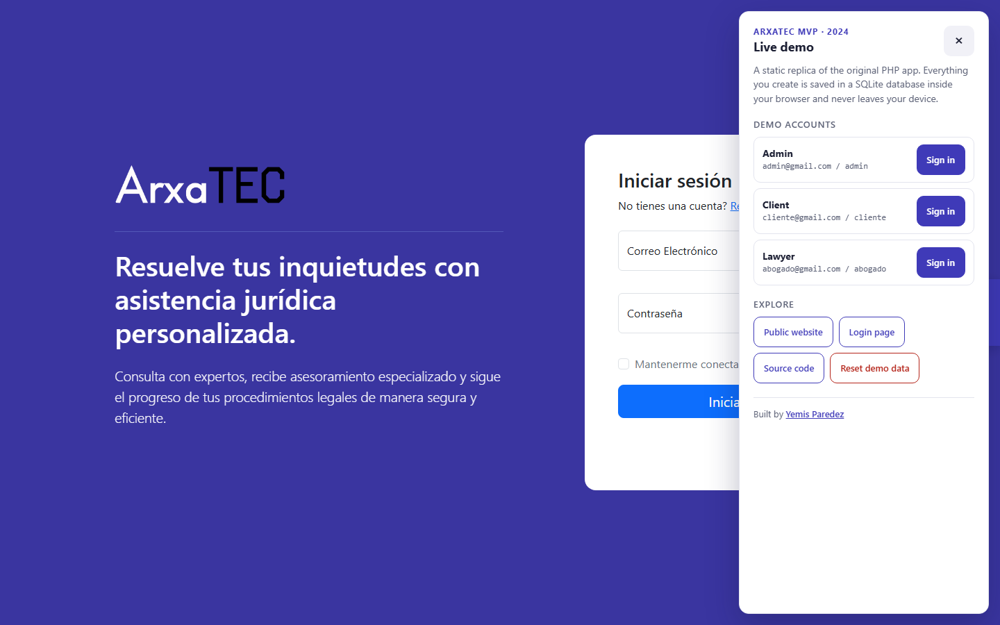
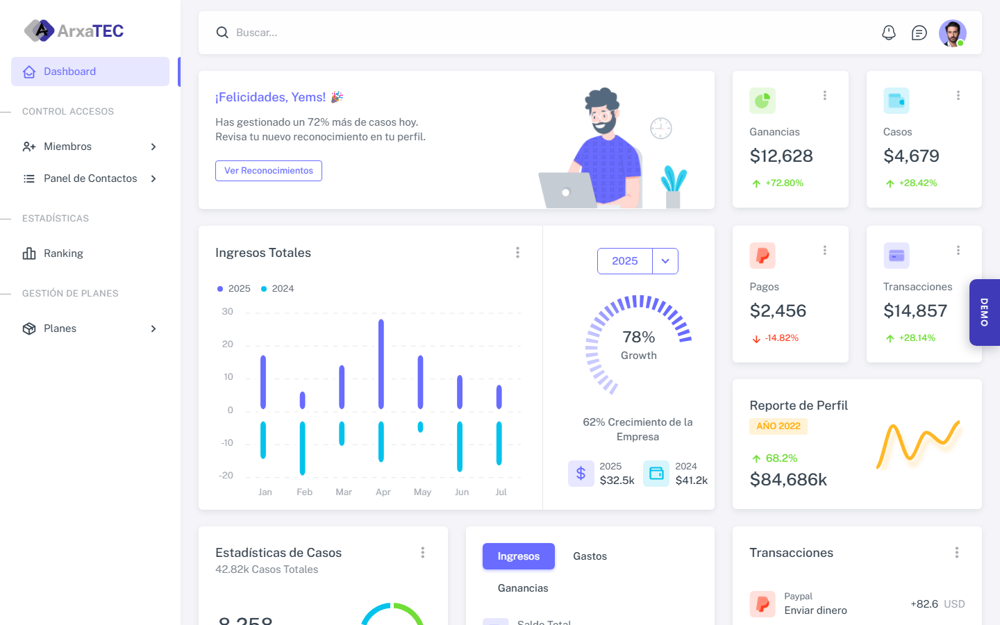
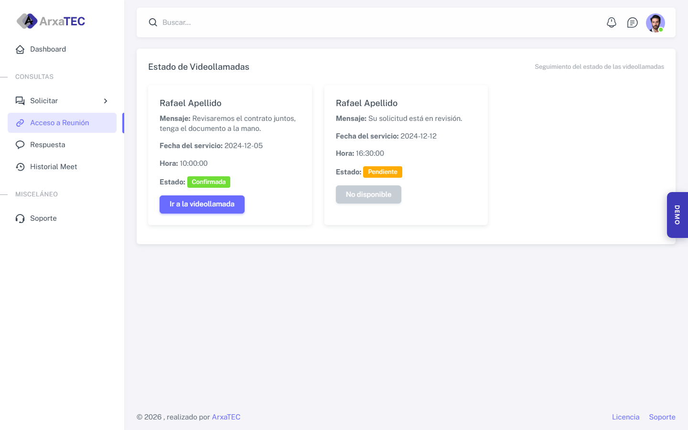
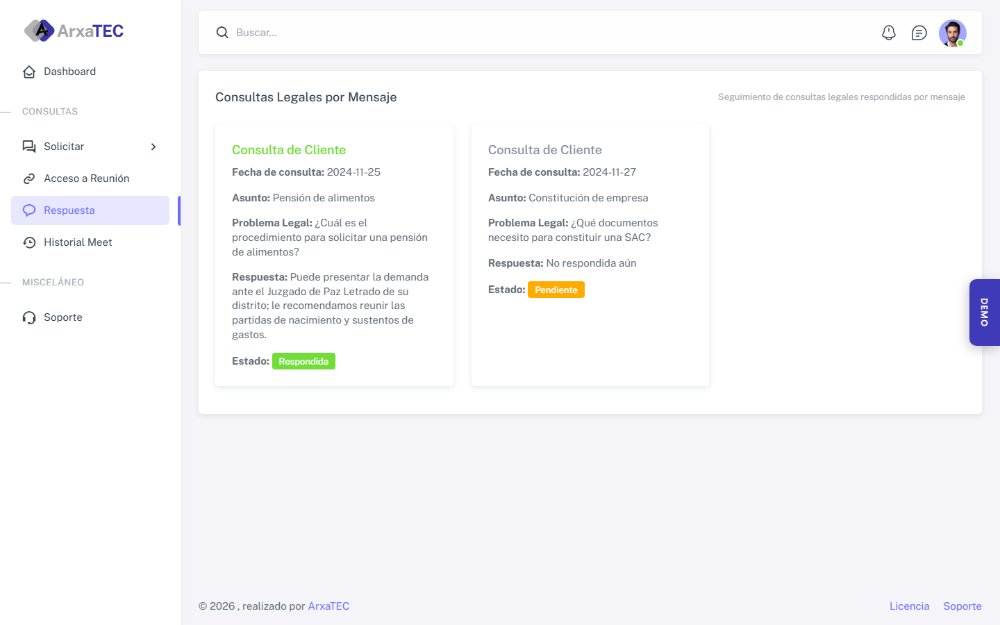

# ARXATEC MVP

**The original MVP of ARXATEC (2024), where it all started.**

ARXATEC began as this web platform: a place where people could get legal advice online, book video consultations with lawyers or ask questions by message, while an admin team managed users and plans. This repository keeps that first version exactly as it was built in 2024, as a record of the project's first steps.

**Live demo:** [arxatec-engine.github.io/arxatec-mvp](https://arxatec-engine.github.io/arxatec-mvp/)
**Author:** [Yemis Paredez](https://linktr.ee/yemis_paredez)



## Author

Designed and built by **[Yemis Paredez](https://linktr.ee/yemis_paredez)**.

## What it does

The app has a public website and three private panels, one per role:

| Role | What they can do |
| --- | --- |
| **Visitor** | Browse the public website (services, plans, testimonials, team, contact) and create a client account. |
| **Client** | Request a video consultation or send a question by message to a lawyer, follow the status of each request and see the history of past consultations. |
| **Lawyer** | Review public and private consultations, confirm meetings and report incidents. These screens were designed but not yet connected to the database. |
| **Admin** | Register admins and lawyers, list every admin, lawyer and client, and manage their own profile (photo, password, personal data). The lawyer ranking and plan screens were early prototypes. |

The interface is in Spanish, as it was for its users in Peru.

| | |
| --- | --- |
|  |  |
|  |  |

## Tech stack

- **PHP 8**, no framework, organized in controllers, models and views per panel.
- **MySQL / MariaDB** through `mysqli`.
- **Bootstrap 5**, a free Bootstrap admin template for the panels and a Colorlib template for the public website.
- jQuery, ApexCharts, Boxicons and Font Awesome.

## Project structure

```text
arxatec-mvp/
├── index.php              # Redirects to the login page
├── auth/                  # Login, registration and password recovery
├── projects/
│   ├── admin/             # Admin panel
│   ├── customer/          # Client panel
│   ├── lawyer/            # Lawyer panel
│   └── shared/            # Assets shared by the panels and profile images
├── web/                   # Public website
├── database/
│   ├── connection/        # mysqli connection
│   └── sql.txt            # Schema and seed data
├── docker/                # Local environment (Apache + PHP + MariaDB)
└── demo/                  # Static live demo (see below)
```

## Run it locally

The original app needs PHP and MySQL. The `docker/` folder recreates the XAMPP setup it was written for, so the code runs unchanged.

Requirements: [Docker Desktop](https://www.docker.com/products/docker-desktop/).

```bash
cd docker
docker compose up -d --build
```

| Service | URL |
| --- | --- |
| App | http://localhost:8090 |
| phpMyAdmin | http://localhost:8091 |
| MariaDB | `localhost:3307`, user `root`, no password |

The database is created from `database/sql.txt` the first time. To start again from the seed data, run `docker compose down -v` and then `docker compose up -d`.

Without Docker, copy the project into XAMPP's `htdocs`, import `database/sql.txt` in phpMyAdmin and open `http://localhost/<folder>/`.

### Demo accounts

| Role | Email | Password |
| --- | --- | --- |
| Admin | `admin@gmail.com` | `admin` |
| Client | `cliente@gmail.com` | `cliente` |
| Lawyer | `abogado@gmail.com` | `abogado` |

## Live demo

The live demo runs entirely in the browser, with no server and no shared database:

- **Same interface.** Its pages are the HTML that the PHP app renders, captured from the running app, with the original CSS, JavaScript and images.
- **SQLite in the browser.** A small runtime replaces the PHP backend: it runs the same queries as the original models against a SQLite database ([sql.js](https://sql.js.org)) created from the same schema and seed data.
- **Private to each visitor.** The database is saved in the visitor's browser (IndexedDB). What one visitor creates is never sent anywhere and nobody else can see it. **Reset demo data** in the demo panel restores the seed.

The only element added to the interface is the **Demo** tab on the right edge. It lists the demo accounts, signs in with one click and links to the public website, this repository and the author.

Differences from the original app:

- The client's status and history pages include a few sample consultations so they are not empty.
- *Create plan* and the admin's *personal data* form save their changes. In the original app their forms point to handlers that were never finished.
- Forms that post to scripts that do not exist in the original app (for example the support form) show a notice instead of an error page.

### Rebuild the demo

Rebuilding is only needed after changing the PHP views. It captures the pages from a temporary copy of the app with a fresh database, so no local test data ends up in the repository:

```bash
cd docker
WEB_PORT=8092 DB_PORT=3308 docker compose -p arxatec-capture up -d --build db web
cd ..
node demo/capture.mjs http://localhost:8092
docker compose -f docker/docker-compose.yml -p arxatec-capture down -v
```

Build and preview it (Node.js 20 or later):

```bash
node demo/build.mjs
node demo/serve.mjs
```

The demo is then at http://localhost:8095. The **Deploy demo to GitHub Pages** workflow builds and publishes it; it runs only when started manually from the Actions tab.

## About this code

This is the MVP as it was written in 2024 and it is kept unchanged on purpose. It is not meant to be deployed as is: passwords are stored in plain text, some queries are built by concatenating input, and a few forms point to scripts that were never written. Those were the next steps when the project moved on.

## License

[MIT](LICENSE) © 2024 [Yemis Paredez](https://linktr.ee/yemis_paredez).

The demo bundles [sql.js](https://github.com/sql-js/sql.js) (MIT). The UI templates and images belong to their respective authors.
